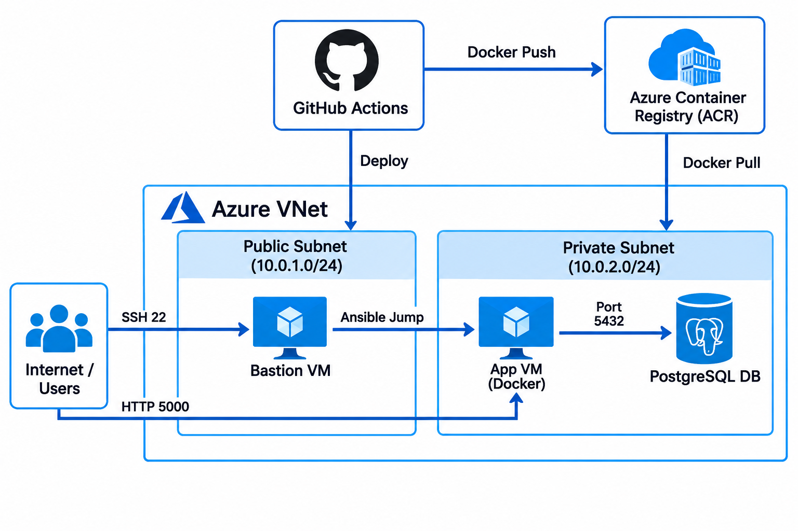

# AgriPrice Tech

AgriPrice Tech is an agricultural market price information platform designed to help farmers and agricultural traders access and manage crop price records across Kigali City and Rwamagana District in Rwanda.

The project uses Flask, PostgreSQL, Docker, and Microsoft Azure, supported by an automated DevSecOps pipeline.

## Live Application

[Access AgriPrice Tech](http://158.158.105.80/)

## Project Coverage

**Locations:**
- Kigali City: Gasabo, Kicukiro, and Nyarugenge.
- Rwamagana District.

**Supported crops:**
Maize, Beans, Rice, Irish potatoes, Sweet potatoes, Cassava, Sorghum, Wheat, Soybeans, Peas, Groundnuts, Tomatoes, Onions, Cabbages, Carrots, Avocados, and Bananas.

The application supports these crops and locations, but verified price records are not necessarily available for all of them.

## Core Features

- View agricultural price records.
- Filter records by crop and district.
- Add, edit, and permanently delete price records.
- Organize records by crop, district, sector, price, and unit.
- Store records in PostgreSQL.
- Server-side input validation.
- CSRF protection.
- Application health monitoring through `/health`.

## Application Access and Security

The application uses public access without registration, login, administrator accounts, or user roles. Anyone accessing the application can view, add, edit, and delete records.

Input validation, parameterized SQL queries, and CSRF protection are implemented to improve application security. CSRF protection does not replace authentication or authorization.

## Architecture



The application is deployed on Microsoft Azure using:

- Azure Virtual Network and Network Security Groups.
- Bastion VM for SSH access and Nginx reverse proxy.
- Application VM running the Docker container.
- Azure PostgreSQL Flexible Server.
- Azure Container Registry (ACR).

## Technology Stack

| Category | Technology |
|---|---|
| Backend | Python, Flask |
| Frontend | HTML, CSS |
| Database | PostgreSQL |
| Application Server | Gunicorn |
| Containerization | Docker, Docker Compose |
| Cloud | Microsoft Azure |
| Infrastructure as Code | Terraform |
| Configuration Management | Ansible |
| CI/CD | GitHub Actions |
| Code Quality | Ruff |
| Testing | Pytest |
| Security Scanning | Checkov, pip-audit, Trivy |

## DevSecOps Pipeline

**Continuous Integration (CI):**
- Ruff for code quality.
- Pytest for automated testing.
- Docker image building.
- Checkov for Terraform security scanning.
- pip-audit for dependency scanning.
- Trivy for container vulnerability scanning.

**Continuous Deployment (CD):**
- Azure authentication.
- Docker image build and push to Azure Container Registry.
- SSH connection and Ansible deployment to the Application VM.

## Getting Started

### Prerequisites

- Python 3.11
- Git
- PostgreSQL

### Installation

Clone the repository:

```bash
git clone https://github.com/Rwema01/agriprice-alert.git
cd agriprice-alert
```

Create and activate a virtual environment:

```bash
python3 -m venv .venv
source .venv/bin/activate
```

Install dependencies:

```bash
pip install -r requirements.txt
```

Configure environment variables:

```bash
export FLASK_SECRET_KEY="your-secure-secret-key"
export DB_HOST="your-postgresql-host"
export DB_PORT="5432"
export DB_NAME="agriprice"
export DB_USER="your-database-user"
export DB_PASSWORD="your-database-password"
export DB_SSLMODE="require"
```

Run the application:

```bash
python app.py
```

Open the application at http://127.0.0.1:5000.

Health check: http://127.0.0.1:5000/health.

A reachable PostgreSQL database with the required schema is necessary.

Never commit database credentials or secret keys to GitHub.

## Testing

Run automated tests:

```bash
python -m pytest -v
```

Check code quality:

```bash
ruff check app.py test_app.py conftest.py
```

Check Python syntax:

```bash
python -m py_compile app.py test_app.py conftest.py
```

Check dependencies:

```bash
python -m pip check
```

## Project Structure

```text
agriprice-alert/
├── .github/workflows/
│   ├── ci.yml
│   └── cd.yml
├── ansible/
├── deployment/
├── terraform/
├── templates/
│   └── index.html
├── app.py
├── test_app.py
├── conftest.py
├── Dockerfile
├── requirements.txt
├── architecture.png
├── AI_USE.md
├── CHANGELOG.md
├── SECURITY.md
├── LICENSE
└── README.md
```

## Project Links

- [GitHub Repository](https://github.com/Rwema01/agriprice-alert)
- [Project Board](https://github.com/Rwema01/agriprice-alert/projects)
- [Live Application](http://68.221.202.79/)

## Team Members

- **Rwema Gisa** – DevOps Lead
- **Kelly Nshuti Dushimimana** – App Lead

## License

MIT License. See [LICENSE](./LICENSE).

## AI Use Declaration

AI tools were used for documentation formatting, Markdown writing, and debugging error logs, as permitted by the course policy.

Core Terraform, Ansible, and CI/CD YAML configurations were written manually.

See [AI_USE.md](./AI_USE.md) for details.
